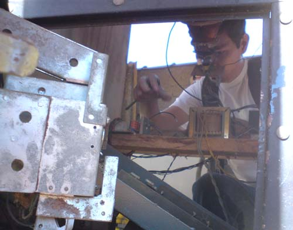

# Dec-ROM - EPROM Bit Reorganizer



*Me taking the board out of the machine, in 2009.*

A Rust (egui) desktop tool for recovering the correct address/data bit
wiring of a scrambled EPROM dump. Load a `.bin`/`.rom`/`.hex` file, run
Auto-Fix to search for the address- and data-bit permutation that decodes
it back into genuine Z80 code, review the result, and save the fixed file
(or the recovered mapping as a `.txt` scramble scheme).

## Why this exists

In 2009 I [took a board out of an arcade machine](https://www.pakequis.com.br/2009/05/placa-msx-que-encontrei-dentro-de-uma.html)
that turned out to be MSX hardware. I read the BIOS and game EPROMs (a
Knightmare) and kept the `.bin` files. The contents were scrambled: address
and data lines were wired out of order between the chip and the rest of the
circuit, so the dumps held no code that made sense.

I tried to decode them some time later and failed. Piter Punk is the one who
solved it. He wrote asking for the `.bin` files, I sent them, and he decoded
them.

Years later, with the help of Claude (the AI), I built this tool. The BIOS
from that board (the "ITS ROM" in the old post) is now decoded by Auto-Fix in
about 1 second, and the result is the MSX ROM header ("AB"). That is the
fast path: the wiring of this board is now one of the known patterns Auto-Fix
tries before it starts the general search. What blocked me in 2009 takes a
second today.

## How it works

1. Load a `.bin`, `.rom` or `.hex` file.
2. Auto-Fix searches for the swap of address and data lines that turns the
   content into real Z80 code.
3. Review the result, then save the fixed file or only the swap scheme as a
   `.txt`.

Manual bit mapping and Save work on any file up to 64KB, the size of the Z80
address bus. The Auto-Fix search itself targets Z80 only.

The `.txt` scheme is the format the MSX community already used to exchange
scramble schemes: the one from the program "Codificador/Decodificador de ROM
para EPROM" (ROM/EPROM encoder and decoder) by A&L Software, from 2004.
Dec-ROM reads and writes it, so old schemes that are still circulating can be
reused.

## Acknowledgments

Testing a tool like this needs genuinely scrambled files, preferably with the
correct answer at hand. Two sources helped a lot:

- **Alexandre Souza ([Tabajara](https://tabajara-labs.blogspot.com/))** found
  a Fort Games board and made the binaries available. That scrambling was
  different from the one on my board. The automatic search never solved it
  within the time I allowed, until I had the Fort Games wiring scheme. With it,
  the tool recognizes the board in under a second.
- **[MSXPro](https://www.msxpro.com/news.html)**, where I got other binaries.
  A correct decode shows unmistakable signs, like the "AB" header of MSX
  ROMs, and that served as a check.

## Building and running

```
cargo run --release       # launch the GUI
cargo test --lib          # unit tests (those needing local samples/ are skipped)
```

On Linux the native file dialogs need GTK 3 development headers
(`libgtk-3-dev` on Debian/Ubuntu, `gtk3-devel` on Fedora).

The full `cargo test` run also exercises integration tests under
[`tests/`](tests/) that load real EPROM dumps from a local `samples/`
directory. Those dumps may contain third-party content, so they are not
committed (see [`.gitignore`](.gitignore)). Without them the integration
tests fail by design, and the unit tests that read from `samples/` are
skipped with a notice. Only `cargo test --lib` is expected to pass from a
clean checkout.

## Releases

The workflow in [`.github/workflows/release.yml`](.github/workflows/release.yml)
builds native Windows and Linux binaries, and runs clippy and the unit tests,
on every push to `main` and on pull requests. Pushing a `v*` tag also attaches
the binaries to a GitHub Release.

## Notes

If you have a scrambled MSX EPROM and want to try it, Dec-ROM solves the
cases I was able to verify. If it fails on yours, send me the `.bin` and I
will take a look.

## License

MIT - see [`LICENSE`](LICENSE).
